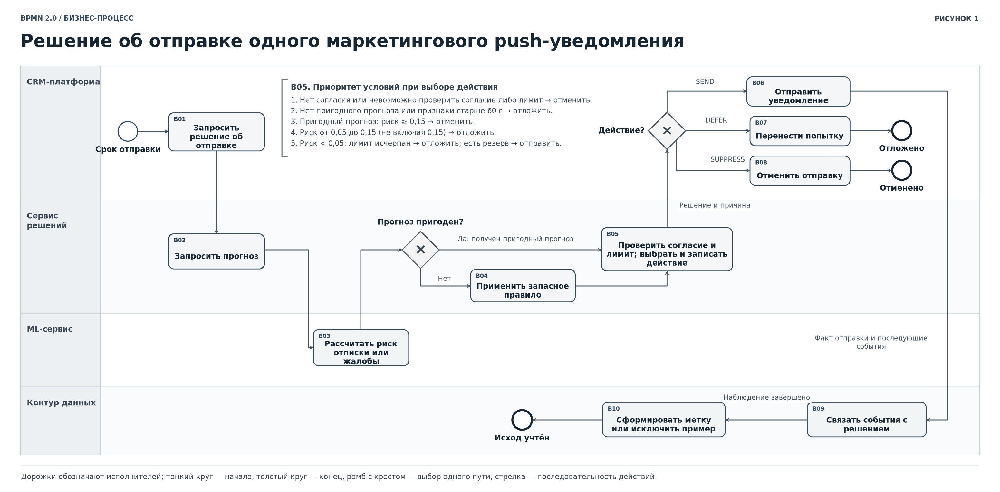
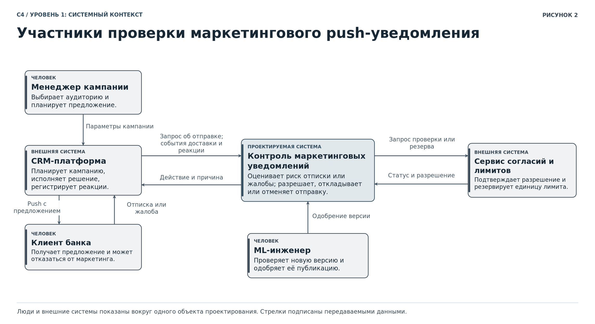
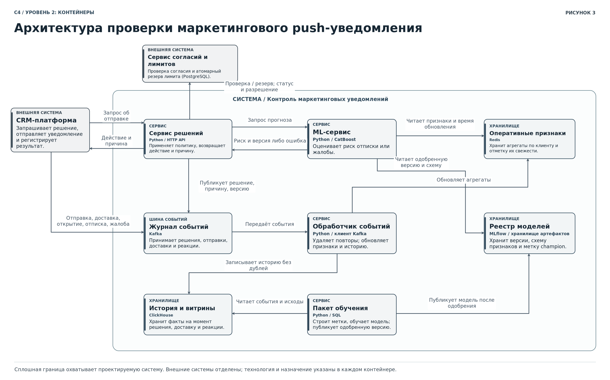
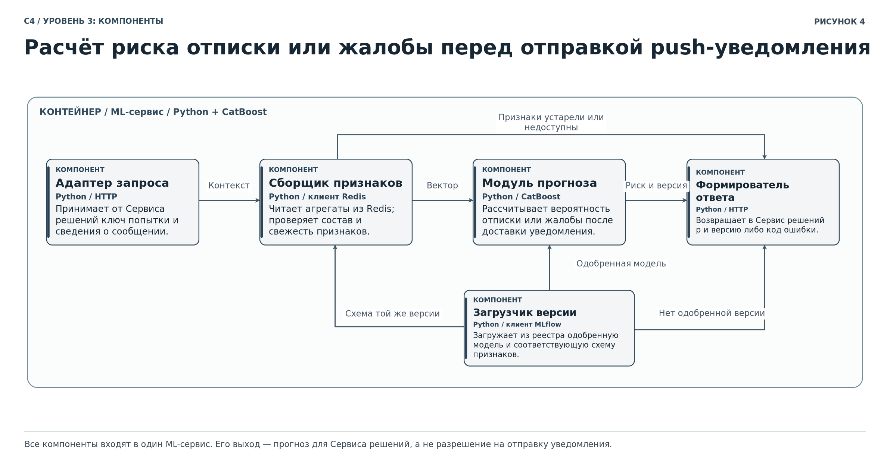

# Решение об отправке маркетингового push-уведомления клиенту банка

Розничный банк подготовил для клиента персональное предложение в мобильном приложении. Когда наступает запланированное время отправки, платформа управления кампаниями и рассылками (далее — CRM-платформа) должна решить, **отправить это предложение сейчас, отложить его или отменить**. Решение касается одного сообщения одному клиенту: если клиент недавно получил несколько предложений, ещё одно обращение может привести к жалобе или отказу от рассылки.

**Модель** оценивает вероятность жалобы или отписки после доставки. **Сервис решений** учитывает этот прогноз, согласие клиента и допустимую частоту контактов, а затем возвращает действие платформе рассылок. 

## 1. Бизнес-процесс и условия отправки

*Рисунок 1. Проверка одной попытки отправки маркетингового push-уведомления (BPMN).*

После запроса CRM Сервис решений вызывает сервис машинного обучения (далее — **ML-сервис**). На вход модели поступают характеристики предложения и сведения, доступные до решения: число маркетинговых контактов за 24 часа и за 7 дней, время с последнего контакта, доля открытых сообщений за 30 дней. 

ML-сервис возвращает `p` — оценку вероятности того, что в течение 72 часов после доставки будет зарегистрирована связанная с ней жалоба или отписка. С ответом передаётся версия модели. Если рассчитанному значению нельзя доверять, сервис возвращает ошибку, а не нулевой риск. Согласие и лимит контактов проверяются независимо от прогноза: даже при `p = 0` отправка без согласия не разрешается.

**Таблица 1. Правила Сервиса решений в порядке приоритета**

| Условие | Действие, передаваемое в CRM |
|---|---|
| 1. Согласия нет или невозможно проверить согласие либо состояние лимита. | **Отменить** (`SUPPRESS`). Запрет имеет приоритет и при отказе модели. |
| 2. Прогноз непригоден: ответ не получен в срок, версия неизвестна, `p` не является конечным числом от 0 до 1 включительно или критичные признаки старше 60 секунд. | **Отложить** (`DEFER`). Число из непригодного ответа не используется. |
| 3. Прогноз пригоден и `p ≥ 0,15`. | **Отменить** это предложение. Согласие на другие сообщения не изменяется. |
| 4. `0,05 ≤ p < 0,15`. | **Отложить** до следующей проверки. |
| 5. `p < 0,05`, но свободного лимита нет. | **Отложить** до следующего допустимого контакта. |
| 6. `p < 0,05`, согласие подтверждено и единица свободного лимита зарезервирована. | **Отправить** (`SEND`). Разрешение действительно для одной попытки. |

Применяется первая подходящая строка. Так, если пришло значение `p = 0,20`, но признаки устарели, при подтверждённом согласии и известном состоянии лимита действует строка 2, а не строка 3. На рисунке 1 первый шлюз проверяет пригодность прогноза; запасное правило **не разрешает отправку и не заменяет проверку согласия**. Второй шлюз направляет CRM по ветви уже принятого решения. Если срок кампании истёк до новой попытки, предложение закрывается без отправки.

## 2. Архитектура системы

### 2.1. Системный контекст

*Рисунок 2. Система контроля маркетинговых уведомлений и её окружение.*

Менеджер планирует предложение в CRM. Для CRM проектируемая система — единая точка проверки отправки. Соседний **Сервис согласий и лимитов** подтверждает, что клиент разрешил маркетинговые обращения и доступный лимит позволяет отправку. Клиент взаимодействует с каналом рассылки, а не с моделью. Инженер машинного обучения отвечает за одобрение версии модели.

### 2.2. Контейнеры

*Рисунок 3. Сервисы, хранилища и потоки данных.*

**При отправке:** Сервис решений получает запрос от CRM. ML-сервис читает оперативные признаки из Redis, рассчитывает `p` и возвращает прогноз либо ошибку. Сервис решений проверяет согласие и лимит через соседний сервис, применяет таблицу 1 и записывает результат в журнал событий. Перед выдачей `SEND` резервируется единица лимита, чтобы две кампании не использовали одновременно последний доступный контакт. CRM получает действие, причину и идентификатор решения; при переносе — также время следующей проверки. Отсутствие ответа не считается разрешением.

**После отправки:** CRM передаёт в журнал Kafka события отправки, доставки, открытия, жалобы и отписки. Обработчик событий удаляет повторы по идентификатору события, обновляет признаки в Redis и сохраняет историю в ClickHouse. Пакет обучения читает историю и формирует обучающую выборку; после одобрения модель вместе со схемой признаков публикуется в реестре MLflow как действующая версия (`champion`). Обучение не выполняется во время обработки запроса CRM.

### 2.3. Компоненты ML-сервиса

*Рисунок 4. Компоненты ML-сервиса, вызываемого на шаге B02.*

Адаптер принимает запрос Сервиса решений. Загрузчик получает из реестра действующую модель и схему её входных данных. Сборщик признаков объединяет сведения о сообщении с агрегатами из Redis и проверяет их состав и свежесть. Модуль прогноза вычисляет `p`; Формирователь ответа возвращает `p` и версию модели либо код ошибки. Если реестр временно недоступен, допустимо использовать уже загруженный одобренный комплект. Если его нет, прогноз не выдаётся. **Пороги отправки не входят в модель:** они применяются Сервисом решений после возврата ответа.

## 3. Соответствие задач BPMN и элементов C4

| Задача на рисунке 1 | Исполнитель или контейнер | Результат |
|---|---|---|
| B01. Запросить решение об отправке | CRM-платформа → Сервис решений | Переданы идентификаторы клиента, кампании, сообщения, попытки и параметры предложения. |
| B02. Запросить прогноз | Сервис решений → ML-сервис | Передан запрос на оценку риска. |
| B03. Рассчитать риск отписки или жалобы | ML-сервис; компоненты на рисунке 4 | Возвращены прогноз и версия либо ошибка. |
| B04. Применить запасное правило | Сервис решений | При непригодном прогнозе предложен перенос; отсутствие согласия всё равно ведёт к отмене. |
| B05. Проверить согласие и лимит; выбрать и записать действие | Сервис решений, Сервис согласий и лимитов, Журнал событий | Зафиксированы действие и причина; при отправке получен резерв. Решение передано в CRM. |
| B06. Отправить уведомление | CRM-платформа | Уведомление передано на доставку. Это ещё не подтверждение доставки. |
| B07. Перенести попытку | CRM-платформа | Назначена новая проверка; старое решение не разрешает отправку. |
| B08. Отменить отправку | CRM-платформа | Предложение закрыто без отправки клиенту. |
| B09. Связать события с решением | CRM-платформа, Журнал событий, Обработчик событий, История и витрины | События сопоставлены по идентификаторам решения, сообщения и отправки. |
| B10. Сформировать метку или исключить пример | Пакет обучения, История и витрины | Для оценки и обучения получена метка либо указана причина исключения. |

## 4. Обратная связь и оценка качества

После подтверждённой доставки начинается 72-часовое окно наблюдения. **Метка 1** означает, что зарегистрирована отписка или жалоба, которую можно связать с конкретной доставкой. **Метка 0** присваивается только после закрытия окна, если таких событий не было и учёт реакций работал исправно. Само по себе отсутствие открытия не считается жалобой. Для отменённого, отложенного или недоставленного предложения реакция на доставку неизвестна: это **не пример с меткой 0**. Реакция без надёжной привязки к сообщению также не используется для разметки.

Для проверки самого прогноза выбраны два критерия: насколько хорошо модель выделяет редкие негативные реакции (площадь под кривой «точность — полнота», PR-AUC) и совпадает ли прогнозируемый риск с наблюдаемой частотой реакций. Проверка проводится на доставленных сообщениях из более позднего периода, не использованного для обучения. Эффект правил отправки требует отдельного эксперимента: сравнения прежних правил с правилами, дополненными прогнозом. Сравнивать следует отписки и жалобы на 1 000 клиентов каждой группы, а также долю клиентов, воспользовавшихся предложением. 

## 5. Проектные допущения

Признаки, пороги риска 5 и 15 %, допустимый возраст критичных признаков 60 секунд, окно наблюдения 72 часа, состав сервисов и технологии на схемах — мои проектные решения, а не параметры, подтверждённые банком. Пороги выбраны для иллюстрации трёх исходов; перед внедрением их требуется проверить по фактическим реакциям клиентов и потерям от пропущенных предложений.

Предполагается, что CRM различает маркетинговые и обязательные сообщения до обращения к системе. Повтор запроса с тем же идентификатором попытки не приводит к повторному резервированию лимита или второй отправке. Без надёжной регистрации решения разрешение на отправку не выдаётся. При обучении используются только признаки, которые были доступны на момент решения; сведения о последующей реакции служат для разметки, а не для расчёта признаков этой попытки.

## 6. Файлы проекта

| Схема | Редактируемый исходник | Изображения |
|---|---|---|
| 1. Бизнес-процесс | [01-process.bpmn](diagrams/01-process.bpmn) · [01-process.mmd](diagrams/01-process.mmd) | [SVG](diagrams/01-process.svg) · [PNG](diagrams/01-process.png) |
| 2. Системный контекст | [02-context.mmd](diagrams/02-context.mmd) | [SVG](diagrams/02-context.svg) · [PNG](diagrams/02-context.png) |
| 3. Контейнеры | [03-containers.mmd](diagrams/03-containers.mmd) | [SVG](diagrams/03-containers.svg) · [PNG](diagrams/03-containers.png) |
| 4. Компоненты ML-сервиса | [04-components.mmd](diagrams/04-components.mmd) | [SVG](diagrams/04-components.svg) · [PNG](diagrams/04-components.png) |
