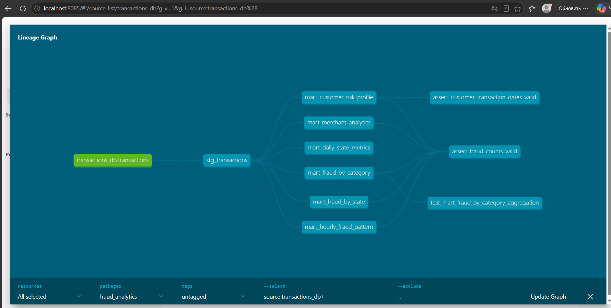

# MLOps 5

## 1. Запуск проекта

Все команды выполняются из корневой директории репозитория.

### Запуск Docker Compose
```bash
docker compose up -d --build

docker compose ps
```
### Первоначальная загрузка данных

Разместите обучающий CSV-файл по пути `data/train.csv`, затем выполните:
```bash
docker compose run --rm ml-cli scripts/load_labeled_csv.py --csv data/train.csv
```
Исходная целевая переменная `target` при загрузке преобразуется в `is_fraud`.

**Важно:** скрипт загрузки очищает ранее загруженную размеченную выборку и состояние обучения. Повторно запускать его следует только при намеренном сбросе данных.

Если после загрузки не инициализировался указатель обучения, его можно восстановить:
```bash
docker compose exec clickhouse clickhouse-client --user analyst --password analyst_password --query "INSERT INTO fraud.training_state (id, next_month) SELECT 1, addMonths(toStartOfMonth(min(transaction_time)), 2) FROM fraud.labeled_transactions"
```
Эта команда предназначена только для первоначальной инициализации при отсутствии записи в `training_state`.

## 2. Apache Airflow

Веб-интерфейс доступен по адресу:

http://localhost:8081

При первом запуске Airflow в режиме `standalone` создаёт учётную запись администратора.

Пароль можно получить командой:
```bash
docker compose exec airflow cat /opt/airflow/standalone_admin_password.txt
```
В проекте реализованы три DAG:

| DAG | Назначение | Расписание |

|---|---|---|

| `fraud_supply_month` | Генерация очередного месяца размеченных данных | Каждые 5 минут, начиная с минуты 0 |

| `fraud_retrain` | Обучение, оценка и публикация модели | Каждые 5 минут, со сдвигом на 2 минуты |

| `fraud_data_quality` | Проверка качества данных и HTML-отчёт | Каждые 15 минут |

Генерация и переобучение разнесены по времени для снижения вероятности одновременного обращения к данным. При этом расписания не образуют строгую меж-DAG-зависимость: если необходимый месяц отсутствует, задача обучения пропускает неполное окно и может обработать его при следующем запуске.

Для первоначальной проверки рекомендуется вручную запустить `fraud_retrain` через **Trigger DAG**, а затем включить автоматические расписания.

Airflow использует `SequentialExecutor` и локальную SQLite-базу.

## 3. Переобучение модели

DAG `fraud_retrain` использует скользящее окно длиной три календарных месяца.

- Первые два месяца используются для обучения.

- Третий месяц используется для тестирования.

- Алгоритм классификации — `CatBoostClassifier`.

- Основная метрика — **Average Precision (AP)**.

### Quality gate

После обучения новая модель сравнивается с текущей опубликованной моделью на одной и той же тестовой выборке.

Новая версия публикуется при выполнении условия:

`AP(candidate) >= AP(production)`

Если кандидат показывает худшее качество, действующая модель сохраняется.

После завершения сравнения указатель обучения переходит к следующему календарному окну, включая случаи отклонения кандидата. Это предотвращает блокировку последующих циклов обучения из-за одного неудачного месяца.

Активная модель определяется файлом `/models/current.json`, а файлы моделей сохраняются в формате `.cbm`.

### Проверка состояния
```bash
docker compose exec fraud-scorer cat /models/current.json
```
```bash
docker compose exec clickhouse clickhouse-client --user analyst --password analyst_password --query "SELECT * FROM fraud.training_state FINAL"
```
Результаты сравнения моделей доступны в XCom соответствующего запуска Airflow.

## 4. Генерация размеченных данных

DAG `fraud_supply_month` создаёт очередной календарный месяц на основе существующих размеченных транзакций.

Генерация выполняется при совпадении указателя обучения с отсутствующим следующим месяцем данных.

Для нового месяца формируется до 10 000 синтетических записей с переносом дат и сохранением исходных признаков и меток.

После успешного добавления выполняется очистка данных за пределами периода хранения в 36 месяцев.

**Ограничение:** синтетические записи формируются из исторических транзакций. Это позволяет продемонстрировать автоматизацию ML-конвейера, но не заменяет независимую тестовую выборку для оценки качества модели в реальной эксплуатации.

Проверка данных по месяцам:
```bash
docker compose exec clickhouse clickhouse-client --user analyst --password analyst_password --query "SELECT toYYYYMM(transaction_time) AS month, count() AS transactions FROM fraud.labeled_transactions GROUP BY month ORDER BY month DESC LIMIT 10"
```
## 5. Онлайн-скоринг транзакций

Сервис `fraud-scorer` получает сообщения из Kafka, формирует признаки и рассчитывает прогноз мошенничества.

Результат включает:

- `transaction_id` — идентификатор транзакции (UUID добавляется producer, если поле отсутствует);
- `score` — оценку вероятности мошенничества;

- `fraud_flag` — бинарное решение модели;

- `model_version` — версию использованной модели;
- `us_state`, `merch`, `cat_id` — поля для аналитических фильтров, если присутствуют во входном сообщении.

### Отправка тестовых транзакций

После публикации первой модели:
```bash
docker compose run --rm producer --csv data/test.csv --limit 1000
```
Просмотр логов:
```bash
docker compose logs --tail=100 fraud-scorer
```
Проверка результатов:
```bash
docker compose exec clickhouse clickhouse-client --user analyst --password analyst_password --query "SELECT model_version, count() AS transactions, countIf(fraud_flag = 1) AS detected_fraud, round(avg(score), 4) AS avg_score FROM fraud.scoring_results GROUP BY model_version ORDER BY model_version"
```
Результаты нового конвейера сохраняются в PostgreSQL `public.scoring_results`.

Сервис проверяет актуальную версию модели при обработке сообщений, что позволяет использовать опубликованную модель без ручного перезапуска контейнера.

## 6. Data Quality

DAG `fraud_data_quality` выполняет шесть проверок:

| Проверка | Описание |

|---|---|

| Nonempty dataset | Набор данных не пуст |

| No null times | Время транзакции заполнено |

| Valid target | Значения целевой переменной допустимы |

| Nonnegative amounts | Суммы транзакций неотрицательны |

| Nonempty category | Категории транзакций заполнены |

| Both target classes | Присутствуют оба класса целевой переменной |

Для каждой проверки формируется статус `PASS` или `FAIL`.

Результат сохраняется в HTML-файле в общем Docker volume `reports`.

Просмотр отчётов:
```bash
docker compose exec airflow ls -lh /reports
```
## 7. Структура проекта

| Файл или директория | Назначение |

|---|---|

| `docker-compose.yml` | Конфигурация сервисов |

| `requirements.txt` | Python-зависимости |

| `scripts/produce_csv.py` | Отправка CSV-транзакций в Kafka |

| `scripts/load_labeled_csv.py` | Загрузка размеченной выборки в ClickHouse |

| `sql/01_schema.sql` | Исходные аналитические таблицы ClickHouse |

| `sql/05_ml_schema.sql` | Таблицы ML-конвейера |

| `mlops/features.py` | Подготовка признаков |

| `mlops/model_store.py` | Хранение и публикация моделей |

| `scoring/consumer.py` | Онлайн-скоринг Kafka-сообщений и метрики Prometheus |
| `results_writer/consumer.py` | Запись скоринга в PostgreSQL и метрики writer |
| `postgres/init.sql` | Создание таблицы результатов при первом запуске с пустым томом |
| `monitoring/prometheus/prometheus.yml` | Задания сбора метрик |
| `monitoring/grafana/provisioning/` | Источники данных, дашборды, правила алертов |
| `monitoring/grafana/dashboards/` | JSON-файлы трёх дашбордов |

| `dags/retrain_model.py` | Переобучение и quality gate |

| `dags/supply_labeled_month.py` | Генерация синтетических данных |

| `dags/data_quality.py` | Проверки Data Quality и HTML-отчёты |

## 8. Проверенные сценарии

В ходе локального тестирования были проверены:

1\. Загрузка 786 431 размеченной транзакции в ClickHouse.

2\. Обучение CatBoost на последовательных трёхмесячных окнах.

3\. Публикация нескольких версий модели.

4\. Отклонение кандидата при ухудшении Average Precision.

5\. Отправка и онлайн-скоринг 1000 Kafka-сообщений.

6\. Генерация дополнительного календарного месяца.

7\. Создание HTML-отчётов Data Quality с шестью успешными проверками.

Автоматическое расписание, устойчивость к повторным запускам и восстановление после частичных сбоев требуют отдельной эксплуатационной проверки.

## 9. Остановка проекта

Остановка контейнеров без удаления данных:
```bash
docker compose stop
```
Повторный запуск:
```bash
docker compose up -d
```
Для сохранения загруженных данных, моделей и состояния Airflow не следует удалять именованные Docker volumes.

## 10. Аналитический слой dbt (ClickHouse)

В проект добавлен аналитический слой на **dbt Core 1.9.8** с адаптером **dbt-clickhouse 1.9.2**. Он преобразует исходные транзакции ClickHouse в витрины для анализа мошенничества. Все команды ниже выполняются из корня репозитория при запущенном Docker Desktop.

### Архитектура и зависимости
```text
transactions_db.transactions (source)

             |

             v

      stg_transactions (view)

             |

             +-- mart_daily_state_metrics

             +-- mart_fraud_by_category

             +-- mart_fraud_by_state

             +-- mart_customer_risk_profile

             +-- mart_hourly_fraud_pattern

             +-- mart_merchant_analytics
```
Staging-модель приводит исходные поля к удобному для анализа виду, добавляет дату, час, день недели и категорию суммы транзакции. Для последней используется собственный Jinja-макрос `amount_bucket`.

**Граф зависимостей (dbt Lineage Graph):**



### Аналитические витрины

| Модель | Назначение |

|---|---|

| `mart_daily_state_metrics` | Ежедневные показатели транзакций и мошенничества по штатам |

| `mart_fraud_by_category` | Частота мошенничества, количество и суммы операций по категориям |

| `mart_fraud_by_state` | Анализ мошенничества по штатам |

| `mart_customer_risk_profile` | Агрегированный профиль клиента и категория риска `HIGH` / `MEDIUM` / `LOW` |

| `mart_hourly_fraud_pattern` | Распределение мошенничества по дням недели и часам |

| `mart_merchant_analytics` | Показатели мерчантов и признак подозрительной активности |

`stg_transactions` материализуется как `view`, шесть аналитических витрин — как `table`.

### Запуск dbt

Установка зависимостей dbt:
```bash
docker compose run --rm dbt deps
```
Построение моделей:
```bash
docker compose run --rm dbt run
```
Полная сборка с тестами:
```bash
docker compose run --rm dbt build
```
Отдельный запуск тестов:
```bash
docker compose run --rm dbt test
```
### Проверки качества

Реализованы **79 тестов**:

- **76 generic tests**: проверки значений, диапазонов, уникальности и других ограничений моделей;

- **2 singular SQL tests**: `assert_fraud_counts_valid` и `assert_customer_transaction_dates_valid`;

- **1 unit test**: `test_mart_fraud_by_category_aggregation`, проверяющий агрегацию на заданных тестовых транзакциях.

В ходе локальной проверки все 79 тестов прошли успешно (generic и singular — при отдельных запусках, unit — отдельно). Для воспроизведения общего результата рекомендуется запускать `dbt build`.

Используются пакеты `dbt_utils` и `dbt_expectations`, подключённые через `dbt/packages.yml`.

### SQLFluff и pre-commit

Для проверки SQL используется **SQLFluff 3.3.1** с диалектом ClickHouse и dbt-templater. Конфигурация находится в `dbt/.sqlfluff`.

Проверка всех SQL-моделей:
```bash
docker compose run --rm --entrypoint sqlfluff dbt lint models
```
В корне репозитория находится `.pre-commit-config.yaml`: локальный Git-хук запускает SQLFluff в Docker. Для ручной проверки на Windows (при установленном `pre-commit`):
```powershell
python -m pre_commit run --all-files
```
Проверка выполняется перед коммитом, если хук установлен командой `python -m pre_commit install`. Для её работы необходим запущенный Docker Desktop.

### Makefile

В корне репозитория предусмотрен `Makefile` с целями `dbt-deps`, `dbt-run`, `dbt-test`, `dbt-build`, `dbt-docs`, `lint` и `check`. Например, при наличии GNU Make:
```bash
make dbt-build

make lint
```
На Windows, если `make` не установлен, можно запускать соответствующие команды `docker compose` напрямую.

### Документация dbt

Сгенерировать документацию и каталог объектов:
```bash
docker compose run --rm dbt docs generate
```
Открыть локальный интерфейс dbt Docs:
```bash
docker compose run --rm -p 8085:8085 dbt docs serve --host 0.0.0.0 --port 8085
```
Адрес интерфейса: http://localhost:8085.

Каталоги `dbt/target/`, `dbt/dbt_packages/` и `dbt/logs/` содержат генерируемые артефакты и устанавливаемые зависимости; их следует исключить из Git через `.gitignore`.

## 11. Мониторинг ML-сервиса — домашнее задание 5

### Архитектура

`producer` → Kafka `fraud_transactions` → `fraud-scorer` (CatBoost) → Kafka `fraud_scoring` → `results-writer` → PostgreSQL `scoring_results`.

Prometheus собирает метрики HTTP от `fraud-scorer`, `results-writer` и Node Exporter с интервалом **1 секунда**. Grafana подключается к Prometheus и PostgreSQL, отображает дашборды и алерты. Node Exporter в Docker Desktop на Windows показывает показатели Linux-окружения Docker, а не всей операционной системы Windows.

### Запуск и адреса
```bash
docker compose up -d --build
# либо запуск ключевых сервисов при наличии существующих Kafka и базы:
docker compose up -d fraud-scorer results-writer postgres prometheus node-exporter grafana
docker compose ps
```
| Интерфейс | Адрес | Примечание |
|---|---|---|
| Grafana | http://localhost:3000 | Для локального стенда: `admin` / `admin` |
| Prometheus | http://localhost:9090 | Targets: http://localhost:9090/targets |
| Скоринг `/metrics` | http://localhost:8001/metrics | Экспортёр `fraud-scorer` |
| Writer `/metrics` | http://localhost:8002/metrics | Экспортёр `results-writer` |
| PostgreSQL | `localhost:5432` | БД `fraud_monitoring`, пользователь `fraud` |
| Airflow | http://localhost:8081 | Если сервис Airflow запущен |

Локальные пароли (`admin`, `fraud_password`, `analyst_password`) предназначены только для демонстрационного окружения; **не используйте их в публичном развертывании**. Перед настоящим развертыванием вынесите секреты в переменные окружения / секрет-хранилище и смените значения.

PostgreSQL создаёт таблицу `public.scoring_results` из `postgres/init.sql` **только при первоначальной инициализации пустого Docker volume**. Для существующего тома файл автоматически повторно не выполняется. Не используйте `docker compose down -v` на окружении с нужными данными.

Проверка таблицы:
```bash
docker compose exec postgres psql -U fraud -d fraud_monitoring -c "\dt"
docker compose exec postgres psql -U fraud -d fraud_monitoring -c "SELECT count(*) FROM scoring_results;"
```
### Список метрик

| Источник | Prometheus metric | Значение |
|---|---|---|
| Scorer | `fraud_scoring_processed_total` | Успешно обработанные транзакции |
| Scorer | `fraud_scoring_duration_seconds` | Гистограмма длительности обработки |
| Scorer | `fraud_scoring_score` | Гистограмма вероятностей фрода |
| Scorer | `fraud_scoring_fraud_total` | Число помеченных фродовых операций |
| Scorer | `fraud_model_reload_total{version=...}` | Загрузки версий модели |
| Scorer | `fraud_model_reload_timestamp_seconds{version=...}` | Время загрузки версии |
| Scorer | `fraud_scoring_last_processed_timestamp_seconds` | Время последнего обработанного сообщения |
| Writer | `fraud_writer_written_total` | Успешные вставки в PostgreSQL |
| Writer | `fraud_writer_write_seconds` | Гистограмма длительности записи |
| Writer | `fraud_writer_fraud_total` | Сохранённые операции с флагом фрода |
| Writer | `fraud_writer_score` | Гистограмма сохранённых скоров |
| Writer | `fraud_writer_last_write_timestamp_seconds` | Время последней успешной вставки |
| Node Exporter | `node_cpu_seconds_total`, `node_memory_*`, `node_network_*`, `node_disk_*`, `node_filesystem_*` | CPU, память, сеть и диск |

**Собственная дополнительная метрика:** `fraud_scoring_last_processed_timestamp_seconds` показывает время последней обработанной транзакции. На панели **Seconds since last transaction** строится `time() - fraud_scoring_last_processed_timestamp_seconds`: если поток прекратился, показатель растёт. Это позволяет диагностировать отсутствие обработки даже при работающем контейнере. Счётчики Prometheus сбрасываются при перезапуске процесса; сумма записей PostgreSQL хранится независимо.

### Дашборды Grafana

Панели автоматически загружаются из `monitoring/grafana/dashboards/` через file provisioning (папка **Fraud Detection**). Их можно открыть в http://localhost:3000/dashboards:

1. **Fraud Detection - Transaction Scoring** (`/d/fraud-scoring`): TPS, задержка скоринга, доля фрода, распределение скоров, загрузки версий, давность последнего сообщения, статистика PostgreSQL по версиям модели, фильтры **US State / Merchant**, фильтруемые TPS и плотность распределения скоров, доля фрода по `cat_id` среди последних 1000 записей и средний скор по мерчантам.
2. **Fraud Detection - Results Writer** (`/d/fraud-writer`): TPS успешных записей, задержка PostgreSQL, число сохранённых фродовых результатов, распределение сохранённых скоров.
3. **Fraud Detection - System Monitoring** (`/d/fraud-system`): загрузка CPU, памяти, сети, диска и файловой системы.

Для SQL-панелей используются поля `us_state`, `merch`, `cat_id` из входного CSV; исторические записи без этих полей не участвуют в соответствующих срезах. На временных графиках выберите интервал, который включает отправку тестовой партии. Фильтры штат/мерчант обновляют SQL-панели, но не глобальные метрики Prometheus, которые публикуются без этих меток.

**Источник истины для дашбордов — JSON в Git.** Изменения только через интерфейс Grafana могут быть недоступны или перезаписаны provisioning. Файл `monitoring/generate_dashboards.py`, если он остался в репозитории, может генерировать более старую версию; не запускайте его без синхронизации с актуальными JSON.

### Проверка живого потока

После публикации модели отправьте ограниченную партию сообщений:
```bash
docker compose run --rm producer --csv data/test.csv --limit 500
docker compose exec postgres psql -U fraud -d fraud_monitoring -c "SELECT count(*) FROM scoring_results;"
```
Скрипт producer добавляет UUID в `transaction_id`, если его нет в CSV. Это необходимо для предотвращения конфликтов уникальности.

Проверки метрик (пример запросов PromQL в Prometheus):
```promql
rate(fraud_scoring_processed_total[1m])
rate(fraud_writer_written_total[1m])
fraud_scoring_score_count
up
```
На странице Targets должны быть **UP**: `prometheus`, `fraud-scorer`, `results-writer`, `node-exporter`. Во время потока `fraud_scoring_processed_total` и `fraud_writer_written_total` растут, а в PostgreSQL появляются новые строки. `rate(...[1m])` может вернуться к нулю спустя некоторое время после завершения короткой партии. Для демонстрации непрерывного потока требуется периодическая отправка небольших партий либо producer с задержкой между сообщениями.

### Смена версии модели

DAG `fraud_retrain` обучает новую модель на трёхмесячном окне и публикует её **только при выполнении quality gate** (`AP(candidate) >= AP(production)`). Новая версия записывается в `/models/current.json`. `fraud-scorer` проверяет указатель при обработке следующего Kafka-сообщения и загружает модель без перезапуска контейнера.
```bash
docker compose up -d airflow
docker compose exec fraud-scorer cat /models/current.json
# Запустить/дождаться завершения DAG fraud_retrain в Airflow, если есть данные
# Затем отправить новые сообщения:
docker compose run --rm producer --csv data/test.csv --limit 100
docker compose logs --tail=30 fraud-scorer
```
В Prometheus проверить `fraud_model_reload_total` и `fraud_model_reload_timestamp_seconds` с меткой `version`, а в PostgreSQL — `model_version`. **Отдельная кратковременная annotation-отметка на графике Grafana ещё не была проверена; график загрузок версий не равнозначен такой отметке.** Если кандидат отклонён quality gate, версия не изменится — это штатный результат.

### Алерты

Два правила находятся в `monitoring/grafana/provisioning/alerting/rules.yml` и должны появляться в **Grafana → Alerting → Alert rules**:

| Правило | Демонстрационный порог | Что отслеживает |
|---|---|---|
| High Fraud Rate | Более 20% за 1 минуту | Доля фродовых решений в новом потоке |
| High Scoring Latency | Среднее время более 0,5 секунды за 1 минуту | Замедление вычисления скора |

Для проверки загрузки убедитесь, что оба правила видны в Alerting. Для проверки срабатывания во время потока можно **временно** уменьшить порог `High Scoring Latency` до `0.000001` секунды, перезапустить Grafana и отправить новую партию; после проверки верните порог `0.5`. Отправка в почту/Telegram не требуется. Для постоянной эксплуатации пороги нужно откалибровать по историческим метрикам.

### Ограничения и воспроизводимость

- Проверены работающие дашборды, SQL-фильтры, Prometheus Targets, алерты и запись транзакций. Полный сценарий с успешной публикацией *новой* версии модели и её annotation в Grafana не проходил завершающую проверку.
- Результаты в PostgreSQL при первом развёртывании будут пустыми, пока не появится опубликованная модель и не начнётся поток Kafka.
- При запуске на Windows Node Exporter собирает данные окружения Docker Desktop; доступность некоторых дисковых метрик зависит от этого окружения.
- Учётные данные в демонстрационном Compose необходимо заменить для реального использования.
